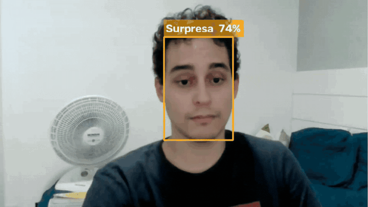
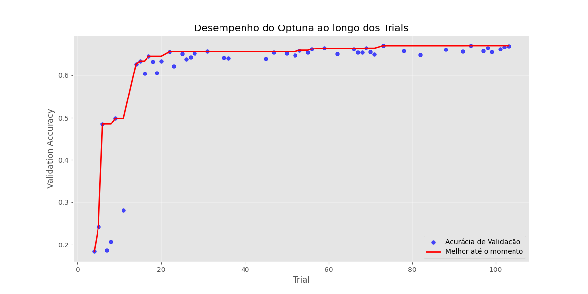

# Reconhecimento de Expressões Faciais em Tempo Real com AnyNet + YOLOv8


O projeto tem duas partes:

1. Uma rede convolucional baseada na família **AnyNet** (Radosavovic et al., 2020), chamada **AnyNetFER**. Ela foi treinada do zero no **FERPlus** para classificar **8 expressões faciais**, com hiperparâmetros escolhidos por busca bayesiana com **Optuna**.
2. Uma aplicação de **webcam em tempo real**: o **YOLOv8n-face** detecta os rostos e a AnyNetFER classifica a expressão de cada um.

<p align="center">
  
</p>

> Trabalho da disciplina de Visão Computacional da **Universidade Federal do Maranhão (UFMA)**, feito por **André Lucas C. da Silva**, **Marcelo A. Heluy** e **Matheus L. Raposo**.
>
> 📄 **[Leia o artigo completo (PDF)](artigo/Reconhecimento_de_Expressoes_Faciais_AnyNet_Optuna.pdf)**

---

## Destaques

- **Arquitetura leve:** cerca de **650 mil parâmetros**, treinada do zero sem pré-treinamento. Funciona em tempo real em CPU ou GPU.
- **67,0% de acurácia de validação** no FERPlus (8 classes) com apenas **8 épocas** por tentativa na busca de hiperparâmetros.
- **Busca bayesiana (TPE) com poda pela mediana:** das 108 tentativas, 55 foram interrompidas cedo, o que economizou cerca de metade do tempo de GPU.
- **Treino resistente a quedas de sessão:** o estudo do Optuna fica salvo em SQLite e os checkpoints são gravados de forma atômica. Se a sessão do Kaggle cair, o treino continua de onde parou.

---

## Pipeline

```
Webcam ─► YOLOv8n-face ─► recorte do rosto ─► escala de cinza 48×48 ─► AnyNetFER ─► expressão + confiança
          (detecção)                          (normalização [-1, 1])    (8 classes)
```

**Classes:** Raiva · Nojo · Medo · Felicidade · Tristeza · Surpresa · Neutro · Desprezo

---

## Arquitetura AnyNetFER

A rede tem um *stem* convolucional, quatro estágios de **blocos residuais com gargalo** (convolução 1×1 → convolução 3×3 agrupada → convolução 1×1, com atalho residual) e uma cabeça de classificação.

| Módulo              | Saída espacial | Canais | Blocos | Passo |
|---------------------|----------------|--------|--------|-------|
| Entrada             | 48×48          | 1      | —      | —     |
| Stem (conv 3×3)     | 24×24          | 32     | 1      | 2     |
| Estágio 1           | 24×24          | 32     | 1      | 1     |
| Estágio 2           | 12×12          | 64     | 2      | 2     |
| Estágio 3           | 6×6            | 128    | 4      | 2     |
| Estágio 4           | 3×3            | 256    | 2      | 2     |
| Global Avg Pool     | 1×1            | 256    | —      | —     |
| Dropout + Linear    | —              | 8      | —      | —     |

**Treinamento:**
- *Cross-entropy* com *label smoothing* de 0,1 e *scheduler* Cosine Annealing.
- *Data augmentation* com espelhamento horizontal, rotação de até ±10° e translação de até 10%.

---

## Otimização de hiperparâmetros com Optuna

**Espaço de busca**

| Hiperparâmetro      | Intervalo / valores        |
|---------------------|----------------------------|
| Taxa de aprendizado | [1e-5, 1e-2] (log)         |
| Weight decay        | [1e-6, 1e-2] (log)         |
| Tamanho do lote     | {32, 64, 128}              |
| Dropout             | [0,2, 0,6]                 |
| Largura de grupo    | {8, 16, 32}                |
| Razão de gargalo    | [0,25, 1,0]                |
| Otimizador          | {AdamW, SGD}               |



**Melhor configuração (Trial 94, 67,02% de acurácia de validação)**

| Hiperparâmetro      | Valor      |
|---------------------|------------|
| Otimizador          | AdamW      |
| Taxa de aprendizado | 1,505e-3   |
| Weight decay        | 1,132e-5   |
| Tamanho do lote     | 32         |
| Dropout             | 0,428      |
| Largura de grupo    | 32         |
| Razão de gargalo    | 0,864      |

**O que a busca mostrou**

- **AdamW dominou:** todos os 10 melhores trials usaram AdamW. Com SGD, a acurácia raramente passou de 30% em 8 épocas.
- **Largura de grupo 32 e razão de gargalo alta (acima de 0,78)** aparecem em quase todas as melhores configurações.
- **Taxas de aprendizado entre 1,5e-3 e 5e-3** concentram os melhores resultados.

Para comparação, o estado da arte no FERPlus passa de 89%, mas com modelos muito maiores e pré-treinados. Aqui o objetivo é uma rede pequena, treinada do zero, que rode em tempo real.

---

## Estrutura do repositório

```
face-expression-recognition-anynet/
├── face_expression_webcam.py      # aplicação de webcam em tempo real (YOLOv8 + AnyNetFER)
├── notebooks/
│   └── anynet_fer_optuna.ipynb    # modelo, busca com Optuna e treino final (Kaggle)
├── models/
│   ├── modelo_visao.pth           # pesos treinados da AnyNetFER
│   └── yolov8n-face.pt            # pesos do detector facial
├── artigo/
│   └── Reconhecimento_de_Expressoes_Faciais_AnyNet_Optuna.pdf
├── images/                        # GIF de demonstração e figuras do README
├── requirements.txt
└── LICENSE
```

---

## Como executar

### Demo em tempo real com webcam

```bash
git clone https://github.com/SEU_USUARIO/face-expression-recognition-anynet.git
cd face-expression-recognition-anynet
pip install -r requirements.txt
python face_expression_webcam.py
```

| Tecla | Ação                                      |
|-------|-------------------------------------------|
| `Q`   | Encerra a aplicação                       |
| `S`   | Salva o frame atual (`captura_HHMMSS.jpg`) |
| `P`   | Pausa / retoma o vídeo                    |

Os limiares de confiança, a câmera usada e o tamanho da janela podem ser ajustados no bloco `CONFIGURAÇÃO` no início do script.

### Treinamento

O notebook [`notebooks/anynet_fer_optuna.ipynb`](notebooks/anynet_fer_optuna.ipynb) foi feito para rodar no **Kaggle com GPU**, usando o [dataset FERPlus no formato ImageFolder](https://www.kaggle.com/datasets/arnabkumarroy02/ferplus). Para rodar em outro lugar, ajuste `TRAIN_DIR`, `VAL_DIR` e `WORK_DIR` na seção de configuração.

---

## Limitações e próximos passos

- A busca usou apenas 8 épocas por trial, o que pode desfavorecer configurações que convergem mais devagar, como as com SGD.
- A profundidade e a largura dos estágios ficaram fixas. Incluí-las no espaço de busca é o próximo passo natural.
- As classes minoritárias (Nojo e Desprezo) tendem a ser mais confundidas. Uma matriz de confusão e mapas **Grad-CAM** ajudariam a entender quais regiões do rosto o modelo usa em cada expressão.

## Referências

- Radosavovic, I. et al. (2020). *Designing Network Design Spaces*. CVPR.
- Barsoum, E. et al. (2016). *Training Deep Networks for Facial Expression Recognition with Crowd-Sourced Label Distribution*. ICMI.
- Akiba, T. et al. (2019). *Optuna: A Next-generation Hyperparameter Optimization Framework*. KDD.
- Loshchilov, I., Hutter, F. (2017). *Decoupled Weight Decay Regularization*.

A lista completa está no [artigo](artigo/Reconhecimento_de_Expressoes_Faciais_AnyNet_Optuna.pdf).

## Licença

O código deste repositório está sob a licença MIT. O detector usa a biblioteca [Ultralytics](https://github.com/ultralytics/ultralytics), que é licenciada sob AGPL-3.0, e os pesos `yolov8n-face.pt` seguem a licença do projeto de origem.

## Autores

- **André Lucas C. da Silva**
- **Marcelo A. Heluy**: [GitHub](https://github.com/SEU_USUARIO) · [LinkedIn](LINK_LINKEDIN)
- **Matheus L. Raposo**
